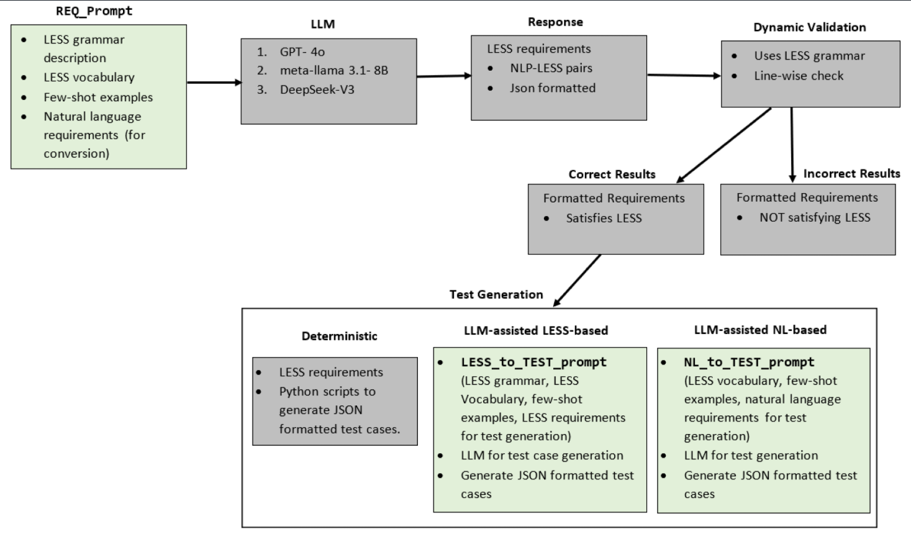
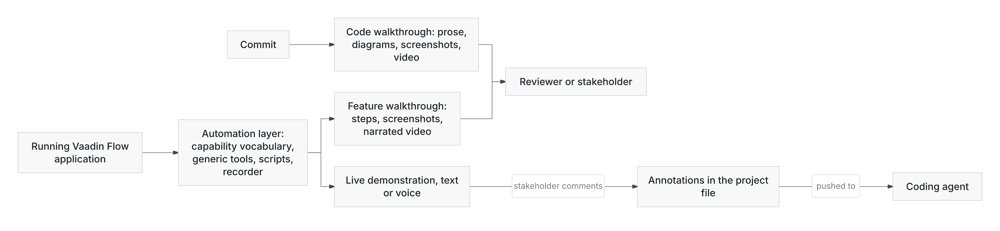
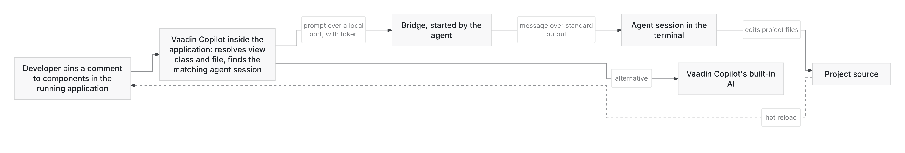
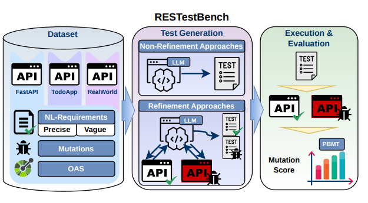
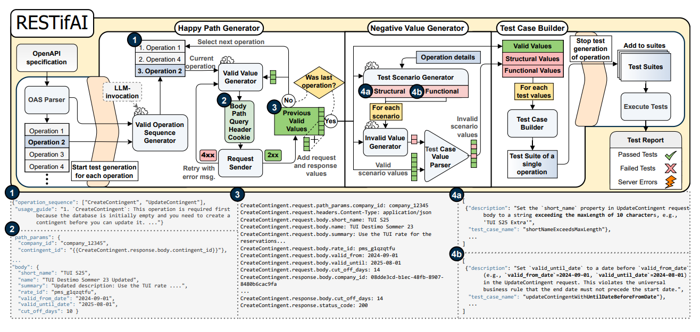
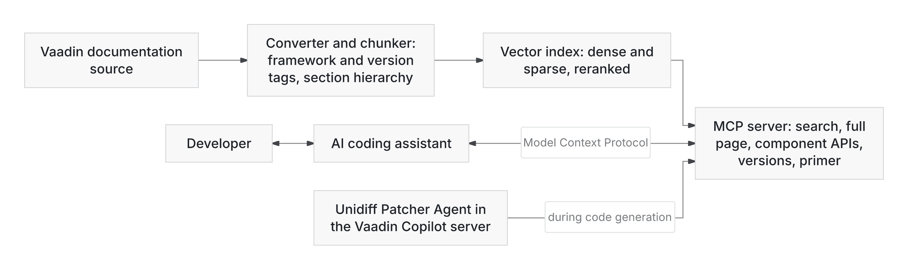
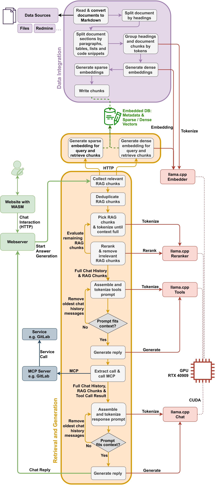
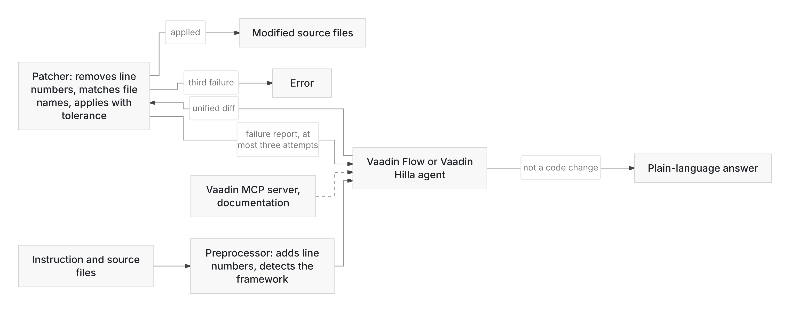

<!-- Generated from the tool submissions. Edit the submissions and run the build script, not this file. -->

# Tools

This page describes the tools that the GENIUS project partners developed. The tools are grouped by the phase of the software lifecycle that they support.

Each tool has a description, its work package (WP), its technology readiness level (TRL), and links. The TRL scale goes from 1 (basic principles observed) to 9 (system proven in an operational environment). Open **More details** for the input and output, the data sources, and the relations to other tools and projects. Some repositories are private. Their owners give access on request.

## Overview

| Tool | Summary | WP | TRL |
|---|---|---|---|
| **Requirements and analysis** | | | |
| [Agentic API Validator](#agentic-api-validator) | A multi-agent system for API validation | WP3 | 3-4 |
| [ECAD PDFAnalyzer](#ecad-pdfanalyzer) |  | WP3 | 3 |
| [HARE-SM Framework / RE Assistant](#hare-sm-framework-re-assistant) | Human-AI requirements engineering assistant | WP3 | 3 |
| [Interview ChatBot for Process Analysis](#interview-chatbot-for-process-analysis) |  | WP3 | 3 |
| [LESS Guidance](#less-guidance) | LESS-Based Requirement and Test Case Generation | WP3, WP5 | 6 |
| **Development and design** | | | |
| [Agentic UI Operation and Automation](#agentic-ui-operation-and-automation) | Exploring how AI agents could operate, automate, and augment existing applications through their UI and application context | WP4 | 2-3 |
| [geneseer APR](#geneseer-apr) | Automated program repair | WP4 | 4 |
| [MASA Codelevate](#masa-codelevate) | A Tool Transforming Jupyter Notebooks to Clean Code Architecture by Leveraging multiple GenAI Agents | WP4 | 5-6 |
| [Reference-Free PDF-to-Markdown Evaluation Tool](#reference-free-pdf-to-markdown-evaluation-tool) | Automated conversion and quality assessment of PDF-to-Markdown conversions | WP3 | 3-4 |
| [TDD Orchestrator](#tdd-orchestrator) | Test driven code generator | WP4 | 3 |
| [Vaadin Copilot and External Agents Tag Team](#vaadin-copilot-and-external-agents-tag-team) | Integrating Vaadin Copilot with external AI agents through interactive communication channels | WP4 | 2-3 |
| **Testing and quality assurance** | | | |
| [ARTIS](#artis) | AI Reverse engineering for Test Integration System | WP3, WP5 | 3 |
| [CoALA](#coala) | Compositional Active Automata learning | WP5 | 2-3 |
| [geneseer Context](#geneseer-context) | Context selection for APR | WP4 | 4 |
| [geneseer SetupTest](#geneseer-setuptest) | Dataset Validation | WP4 | 4 |
| [LACY](#lacy) | Legacy codebase understanding tool | WP4 | 4 |
| [RESTestBench](#restestbench) | Benchmark for requirement-based REST testing | WP5 | 4 |
| [RESTifAI](#restifai) | Reusable LLM REST API testing | WP5 | 4 |
| [UML Class Diagram Generator + LLM Benchmark](#uml-class-diagram-generator-llm-benchmark) | LLM Benchmarking and generated UML Class Diagram sets | WP4 | 3 |
| **Maintenance, operations, and release** | | | |
| [DETANGLE Architecture Modernization](#detangle-architecture-modernization) | Architecture Refactoring | WP4 | 5-6 |
| [Improving AI Awareness of Vaadin Technologies](#improving-ai-awareness-of-vaadin-technologies) | Researching the use of Vaadin MCP to keep AI assistants up to date with the latest Vaadin ecosystem | WP4 | 4 |
| [RAGnaroX](#ragnarox) | Local secure ChatOps RAG assistant | WP2, WP3 | 5 |
| [Unidiff Patcher Agent](#unidiff-patcher-agent) | Evaluating the feasibility of using Unified Diff patches instead of the custom patch format currently used by the AI agent | WP4 | 4 |

## Requirements and analysis

AI-supported elicitation, structuring, and validation.

### Agentic API Validator

*A multi-agent system for API validation*

Agentic API Validator aims to maintain the quality of API services across the Developer Portal and ensure API consistency. To achieve that, it leverages an LLM-driven multi agent system to validate newly exposed APIs, analyze the maturity of the existing API offerings against the market leaders and identify issues prior to releasing these on the portal. By doing so, it enhances the overall developer experience along with the API consistency.

| | |
|---|---|
| Work package | WP3 |
| TRL | 3-4 |
| Use case | Siemens AG |
| Contribution | Proof of concept development for our use-case |
| Contact | <a class="mail" data-m="bW9jLnNuZW1laXNAbGVjbnV0Lmt1cm9k">[email, enable JavaScript]</a>, <a class="mail" data-m="bW9jLnNuZW1laXNAZ25hdC5uYWlqZ25veQ==">[email, enable JavaScript]</a> |

<strong>More details</strong>

**Input and output**

- **Input:** API specification along with user request query
- **Output:** Revised API specification

**Data sources**

Xcelerator Developer Portal API list as a source

[Back to overview](#overview)

### ECAD PDFAnalyzer

Extraction of ECAD data from PDF files stored for further engineering steps as ontologies. Base development for LLM based analysis of engineering data to setup a Virtual Commissioning.

| | |
|---|---|
| Work package | WP3 |
| TRL | 3 |
| Use case | EKS |
| Contribution | Application |
| Contact | <a class="mail" data-m="ZWQuY2V0bmktc2tlQGhjc3JlbS5hbml0">[email, enable JavaScript]</a>, <a class="mail" data-m="ZWQubWllaHNlZGxpaC1pbnVAY2xlem5ldw==">[email, enable JavaScript]</a> |
| Links | [GitHub](https://github.com/EPDF-Extractor/indu-doc-transformer) |

<strong>More details</strong>

**Input and output**

- **Input:** EPlan PDF Export showing the electric configuration of a plant
- **Output:** Ontology containing the information gathered from the PDF

**Data sources**

https://github.com/EPDF-Extractor/indu-doc-transformer/wiki

**Related tools and projects**

Base work for other EKS use cases and tools. Data acquisition.

[Back to overview](#overview)

### HARE-SM Framework / RE Assistant

*Human-AI requirements engineering assistant*

HARE-SM (Human-AI Requirements Engineering Synergy Model) is a human-in-the-loop framework for integrating generative AI into Requirements Engineering while retaining human responsibility for validation and final decision-making. The framework is designed around transparency, explainability, human oversight, and iterative feedback in AI-assisted requirements activities.

The framework is operationalized through a publicly deployed RE Assistant / Acceptance Criteria Assistant, a Streamlit-based research prototype for supporting the preparation and validation of requirements artifacts. Users can provide an existing user story, construct one through a guided interface, or derive candidate user stories from an informal requirement. The system then supports the generation of acceptance criteria using multiple language-model families, with optional retrieval-augmented generation (RAG) that can be configured independently for each selected model.

The prototype supports Google FLAN-T5-Large, Gemini 2.5 Flash, OpenAI gpt-4o-mini, and LLaMA models accessed through Together.ai. Generated outputs are post-processed into a consistent format and displayed side by side so that reviewers can compare alternatives rather than relying on a single model response.

Human validation is an explicit part of the workflow. Reviewers can inspect retrieved context when RAG is enabled, select individual acceptance criteria, edit generated criteria, regenerate alternatives, and manually refine the final set before submission. AI-generated artifacts therefore remain provisional until the reviewer explicitly finalizes them. The system also records configuration information, generated outputs, reviewer actions, selections, edits, and the final submitted artifact, enabling traceability and auditability of the human-AI decision process.

The retrieval component uses a transparent RAG pipeline based on document chunking, TF-IDF vectorization, cosine-similarity ranking, and top-k retrieval. Relevant chunks are supplied as additional context to the selected language model and retain source information for inspection.

The prototype is being used as a research platform for investigating human-AI collaboration, validation, provenance, and responsible use of generative AI in Requirements Engineering. Empirical evaluation of the tool is ongoing, and detailed results are being prepared for scientific publication.

| | |
|---|---|
| Work package | WP3 |
| TRL | 3 |
| Use case | Human-AI assisted requirements engineering and acceptance criteria generation/validation |
| Contribution | Research prototype / AI-assisted Requirements Engineering tool |
| Contact | <a class="mail" data-m="aWYudXlqQGlzYWJiYS5hLm5lZXRhbQ==">[email, enable JavaScript]</a> |
| Links | [Web application](https://re-assistant.streamlit.app) |

<strong>More details</strong>

**Input and output**

- **Input:** Informal requirement or user story
- **Output:** Candidate user stories and AI-generated acceptance criteria for human review, selection, editing, and finalization

**Data sources**

- User stories and acceptance-criteria examples used as retrieval context for RAG
- User-provided requirements/user stories

**Related tools and projects**

Operationalizes the HARE-SM framework within the GENIUS project; currently usable as a standalone research prototype.

[Back to overview](#overview)

### Interview ChatBot for Process Analysis

Use ChatBot as interviewer to gain a detailed view in the VC process. This is pre-work for automatic VC setup via LLMs. The approach should be usable for all kind of process analysis.

The developed tool provides a natural-language interface for querying ontology-based plant knowledge in virtual commissioning environments. It combines a large language model with an ontology-aware retrieval layer connected to a GraphDB knowledge base. Instead of exposing the underlying RDF data directly to the language model, the system uses an orchestrator that interprets user questions, decomposes complex requests into retrieval objectives, and delegates them to specialized tools.

The retrieval layer provides deterministic operations for tasks such as component and context lookup, ontology term definitions, graph-path retrieval, integrity checks, and constrained SPARQL queries. Technical identifiers such as component names, station IDs, and GUIDs are grounded against local ontology representations before further retrieval is performed. Retrieved information is returned as structured evidence to the orchestrator, which can perform additional retrieval steps when required before generating the final answer. SPARQL access is restricted to read-only operations and large result sets are bounded or paginated to maintain controlled and traceable retrieval.

The tool therefore combines the flexibility of natural-language interaction with the reliability of deterministic, task-specific graph operations. Its architecture supports extensibility through additional retrieval tools and specialized subagents. In the evaluation, the agentic approach achieved an 89% pass rate and a mean correctness of 0.93, outperforming the other evaluated prototypes, although this came with a higher response time.

| | |
|---|---|
| Work package | WP3 |
| TRL | 3 |
| Use case | EKS |
| Contribution | Application |
| Contact | <a class="mail" data-m="ZWQuY2V0bmktc2tlQGhjc3JlbS5hbml0">[email, enable JavaScript]</a>, <a class="mail" data-m="ZWQubWllaHNlZGxpaC1pbnVAY2xlem5ldw==">[email, enable JavaScript]</a> |

<strong>More details</strong>

**Input and output**

- **Input:** High level process description of Virtual Commissioning, User Input
- **Output:** Detailed, fine granular process description down to tool-click-sequence for Virtual Commissioning

**Data sources**

EKS high level process description for Virtual Commissioning setup

**Related tools and projects**

This is pre-work for automatic VC setup via LLMs. The results help us to develop the final RF::Suite-LLM-Ecosystem. The approach should be usable for all kind of process analysis.

[Back to overview](#overview)

### LESS Guidance

*LESS-Based Requirement and Test Case Generation*

The Python application implements a prompt-based workflow for guiding large language models (LLMs) in transforming natural-language requirements into requirements compliant with the Language for Embedded Safety and Security (LESS). While approaches such as Grammar-Constrained Decoding (GCD) enforce syntactic validity during model decoding and can require model-level integration and additional implementation overhead, this approach uses structured prompt engineering and Few-Shot Learning (FSL). It can therefore be integrated with different LLMs without modifying their decoding mechanisms.

The generated LESS requirements are syntactically validated against the LESS grammar and evaluated for semantic correctness against the corresponding source requirements. Valid LESS requirements are subsequently used as an intermediate representation (IR) for LLM-supported test-case generation.

*LESS requirements generated using LLMs followed by test case generation. Blocks using LLM prompts are colored green* (<a href="imgs/media/tools/less-guidance-figure1.png" target="_blank" rel="noopener">Open full size</a>)

The application is publicly available to support the replicability of the experiments performed in the paper.

| | |
|---|---|
| Work package | WP3, WP5 |
| TRL | 6 |
| Contact | <a class="mail" data-m="ZWQucmVmb2hudWFyZi5zdWtvZkBhaHRzZXJocy5rZWhzaWhiYQ==">[email, enable JavaScript]</a> |
| Links | [GitHub](https://github.com/Abhishek2271/LESSGuidance), [Paper](https://doi.org/10.1007/978-3-032-07244-3_22) |

<strong>More details</strong>

**Contribution**

- Comparative benchmarking of multiple LLMs for prompt-based generation of structured LESS requirements and subsequent testcases.
- Software prototype

**Input and output**

- **Input:** Natural Language Requirements, domain specific vocabulary, LESS grammar, Few-shot learning examples
- **Output:** LESS DSL aligned requirements and corresponding positive transition test cases

**Data sources**

Public automotive-domain Natural language requirements derived from the Standardized E-GAS Monitoring Concept (Version 6.0).

**Related tools and projects**

LESS is used as one of the formalization approaches in the ED4R tool from Orion Innovation

[Back to overview](#overview)

## Development and design

Tools for code generation, documentation, and modernization.

### Agentic UI Operation and Automation

*Exploring how AI agents could operate, automate, and augment existing applications through their UI and application context*

When an agent implements a use case, someone has to decide whether the result is right. The diff says what changed in the code, not whether the feature behaves as specified or what the change did to the architecture. To a stakeholder who does not read Java it says nothing. This work lets an agent operate the running application to show what it built, and returns the feedback to a coding agent.

The base is an automation layer for Vaadin Flow applications. Because Vaadin Flow keeps the component tree on the server, server-side code can click a button, fill a field or select a row without a browser. Instead of automation code per component type, each component declares the capabilities it offers, such as clickable, settable, selectable or sortable. One engine drives them all. A model then needs only a few generic tools: inspect the interface, list a component's capabilities, apply one, navigate. Scripts, a recorder that turns a person's actions into a script, and a Model Context Protocol interface for external agents all use the same layer. The layer sits in separate modules, apart from the agent and the demonstration application.

A feature walkthrough follows a demo script and uses the layer to work through the use case in the running application. It narrates each step and takes a screenshot of it, then produces a report and a narrated video. To generate the walkthrough, the agent has to use the feature, so the walkthrough also tests it. A code walkthrough explains a commit, also from a script, as prose about the changes, diagrams of where responsibilities sit, before-and-after screenshots of the affected view, and a narrated video.

In a live demonstration, the agent runs a demo script step by step, by text or by real-time voice. A stakeholder can stop it and comment. Each comment is stored as an annotation attached to the step, in the file format that Vaadin Copilot uses for comments. The annotation can be pushed to a connected coding agent to implement the change. A person decides which comments go to the coding agent.

The demonstration application is an employee portal of 18 views with authentication and role-based access, built for agents to operate. It holds code walkthrough scripts for nine use cases and feature walkthrough scripts for eight. One use case has been through both walkthrough generators end to end. The generators are not in the repository.

*Outputs for the people who review the agent's work. Comments from a demonstration are written to a file a coding agent can read.* (<a href="imgs/media/tools/agentic-ui-operation-and-automation-figure1.png" target="_blank" rel="noopener">Open full size</a>)

| | |
|---|---|
| Work package | WP4 |
| TRL | 2-3 |
| Contact | <a class="mail" data-m="bW9jLm5pZGFhdkB5aXJ1eQ==">[email, enable JavaScript]</a> |
| Links | Provided on request: GitHub, Demo application |

<strong>More details</strong>

**Use cases**

- Explain an agent's implementation of a use case to a reviewer or stakeholder who will not read the diff
- Demonstrate a feature in the running application and capture stakeholder feedback in a form that a coding agent can act on
- Operate an existing application through its own user interface instead of a separately built API

**Contribution**

**Knowledge:** how an agent can show and demonstrate what it built to people who will not read the diff and collect their feedback where a coding agent can act on it, and the observation that a feature walkthrough also tests the feature it shows

**Input and output**

- **Input:**
  - A demo script, or a commit to explain
  - The running application
  - A stakeholder's comments during a live demonstration
- **Output:**
  - A feature walkthrough: a report with a screenshot and narration per step, and a narrated video
  - A code walkthrough: prose about the changes, diagrams, before-and-after screenshots and a narrated video
  - Feedback annotations attached to demonstration steps, written to a project file that a coding agent can read

**Data sources**

- The running application: its server-side component tree and routes
- Demo scripts, a narration and an action per step, for feature walkthroughs, code walkthroughs and live demonstrations
- The commit to explain, for code walkthroughs
- An annotation file in the project, in the format of Vaadin Copilot's comments, that holds the feedback from demonstrations
- Third-party language, speech and real-time voice models, for narration and voice interaction

**Related tools and projects**

Writes feedback in the comment file format of [Vaadin Copilot and External Agents Tag Team](#vaadin-copilot-and-external-agents-tag-team), so the same agents can read it. Shares the automation layer with the ITEA project CLEAR, which reports the end-user side, an agent operating an application on a user's behalf

[Back to overview](#overview)

### geneseer APR

*Automated program repair*

The Geneseer APR tool is an automated program repair approach for Java that combines traditional search-based software engineering with generative AI. Its foundation is a genetic algorithm that maintains and evolves a population of program variants. Candidate repairs are generated through conventional mutation operations, such as deleting, inserting, or replacing statements, and are evaluated against the project's test suite using a fitness function. Fault localization is used to focus these modifications on program locations that are more likely to contain the defect.

The distinctive aspect of Geneseer is the integration of LLM calls directly into this genetic search process. Instead of relying exclusively on small, predefined mutations, the LLM can act as an additional mutation operator and propose larger or newly synthesized code changes. These LLM-generated variants become part of the population and can subsequently be refined through further conventional mutations, selection, and crossover. This creates a complementary interaction between the two approaches: traditional mutations provide systematic exploration and incremental refinement, while the LLM can introduce more substantial and semantically informed changes that would be difficult to reach through simple mutations alone. The implementation exposes the probability of using an LLM instead of a conventional mutation as a configurable parameter.

This combination is particularly relevant in the context of GenAI for software engineering because it does not treat an LLM as a standalone code generator. Instead, generative capabilities are embedded into an established search-and-validation process in which candidate changes are continuously evaluated using executable tests. The two approaches have complementary repair capabilities, and the evaluation reported for Geneseer found that some defects could only be repaired through an actual combination of LLM-generated and traditional search-based modifications. Geneseer APR therefore provides an example of a hybrid GenAI approach, in which probabilistic code generation and established software-engineering techniques cooperate within the same repair process rather than replacing one another.

| | |
|---|---|
| Work package | WP4 |
| TRL | 4 |
| Contact | <a class="mail" data-m="ZWQubWllaHNlZGxpaC1pbnVAa3l6Y2Zhcms=">[email, enable JavaScript]</a> |
| Links | [GitHub](https://github.com/adam-sse/geneseer) |

<strong>More details</strong>

**Input and output**

Given a code base and a test suite with at least one failing patch, geneseer creates a patch for the code base that makes all test cases pass

**Related tools and projects**

Code context selection for the LLM prompts builds upon its [fault localization tool](#geneseer-context)

[Back to overview](#overview)

### MASA Codelevate

*A Tool Transforming Jupyter Notebooks to Clean Code Architecture by Leveraging multiple GenAI Agents*

The increasing adoption of Jupyter notebooks in data science and machine learning workflows has created a gap between exploratory code development and production-ready software systems. While notebooks excel at iterative development and visualization, they lack proper software engineering principles, making their transition to production environments challenging. MASA Codelevate is a multiagent system that automatically transforms Jupyter notebooks into well-structured, maintainable Python code repositories. Our system employs three specialized agents — Architect, Developer, and Structure — working in concert through a shared dependency tree to ensure architectural coherence and code quality.

| | |
|---|---|
| Work package | WP4 |
| TRL | 5-6 |
| Use case | Siemens AG |
| Contact | <a class="mail" data-m="bW9jLnNuZW1laXNAbGVjbnV0Lmt1cm9k">[email, enable JavaScript]</a>, <a class="mail" data-m="bW9jLnNuZW1laXNAZ25hdC5uYWlqZ25veQ==">[email, enable JavaScript]</a> |
| Links | [Paper](https://arxiv.org/pdf/2511.07257) |

<strong>More details</strong>

**Input and output**

- **Input:** Jupyter notebook
- **Output:** Refactored codebase

[Back to overview](#overview)

### Reference-Free PDF-to-Markdown Evaluation Tool

*Automated conversion and quality assessment of PDF-to-Markdown conversions*

The Reference-Free PDF-to-Markdown Evaluation Tool is designed to convert PDF documents into Markdown and assess the quality of the resulting conversions without requiring a manually created reference document or gold standard. It integrates multiple PDF-to-Markdown conversion tools and generates alternative Markdown representations of the same input document.

The generated outputs are assessed using three complementary approaches. First, deterministic text- and structure-based metrics compare the Markdown outputs pairwise. Second, a consensus-based evaluation is combined with an LLM-based decider that assesses the generated variants and recommends the most suitable conversion. Third, a Vision-Language Model (VLM) compares individual Markdown sections with the corresponding rendered pages of the original PDF to identify potential omissions, hallucinations, and structural deviations.

The tool provides a web-based interface for document upload, converter selection, execution of the evaluation pipeline, and inspection of the generated results. The resulting Markdown outputs, quality scores, reports, and model-based assessments are presented in a way that supports manual verification and comparison.

Rather than making a fully automated quality decision, the tool provides verifiable indicators that help users identify suspicious conversions and select an appropriate conversion result for subsequent processing, such as the use of converted documents in LLM- or RAG-based pipelines. The current evaluation indicates that the combined assessment can support this prioritization, while its reliability is not yet sufficient for fully automated error assessment.

| | |
|---|---|
| Work package | WP3 |
| TRL | 3-4 |
| Use case | Conversion of PDF documents to Markdown and reference-free assessment of conversion quality |
| Contribution | Application |
| Contact | <a class="mail" data-m="ZWQubWllaHNlZGxpaC1pbnVAanJlaGN0dGVvYg==">[email, enable JavaScript]</a> |

<strong>More details</strong>

**Input and output**

- **Input:** PDF document
- **Output:** Markdown conversions, quality scores, comparison reports, and recommendations for the most suitable conversion

**Data sources**

PDF documents (PURE-Dataset)

[Back to overview](#overview)

### TDD Orchestrator

*Test driven code generator*

The TDD Orchestrator is a governed, AI-native software development assistant that drives code generation through the discipline of test-driven development. It decomposes a natural-language specification into an ordered sequence of TDD steps (RED → GREEN → FIX) and every proposed mutation passes through a governance pipeline — twelve reviewer rules, TDD-phase enforcement, a syntax gate and an output-truncation gate.

Execution follows the TDD contract literally. A RED step must produce a test that genuinely fails, and fail for the intended reason; a GREEN step must make that test pass while not breaking any test that passed in a baseline captured before the first mutation; failures enter a bounded repair loop supplied with distilled failure context. The target project is never modified in place — it is ingested into an isolated session workspace, where all work happens with a complete audit trail (structured event log, plan, per-call prompts and provenance, mutation record, run metrics). The tool runs against either cloud models (via OpenRouter) or local models (via Ollama) and offers a command-line interface and a local web UI. Runs are either interactive with per-patch-set human approval, or fully autonomous.

The system serves a dual role. As a tool, it provides a controlled, auditable way to apply generative AI to incremental software change. As a research instrument, it is the apparatus for a controlled multi-benchmark study of whether TDD improves AI coding agents.

| | |
|---|---|
| Work package | WP4 |
| TRL | 3 |
| Contribution | Code generation tool |
| Contact | <a class="mail" data-m="aWYudXlqQG5lbmlhbGl0b2sueXJ5cA==">[email, enable JavaScript]</a> |
| Links | [Preprint](https://arxiv.org/abs/2604.26615) Was presented in Prompt-SE. |

<strong>More details</strong>

**Input and output**

- **Input:** Natural language coding task specification and the project repository
- **Output:** Modified repository and traceability artifacts

[Back to overview](#overview)

### Vaadin Copilot and External Agents Tag Team

*Integrating Vaadin Copilot with external AI agents through interactive communication channels*

Many developers keep an AI coding agent running in a terminal while they work. Such an agent sees the project files but not the running application. It does not know which view is open, which component was just clicked, or which source file contains it. Vaadin Copilot, a development-time extension running inside the developer's application, does. The question is whether Copilot can hand that context, with a prompt, into an agent session it did not start.

The work extends Copilot's comment panel, in which a developer pins a comment to components in the running application. A comment now also records the view class and source file it belongs to. One click sends it, with the route, view class, file and component names, to the agent in the developer's terminal or to Copilot's built-in AI. The agent edits the files with its own tools, and the change appears in the running application through hot reload.

If the developer chooses Copilot's built-in AI, Copilot builds the prompt from the comment and handles it like any other request. The request goes to the Copilot server, and the answer comes back as modified files. If the developer chooses their own agent, the prompt has to reach the agent session already running in their terminal.

The agent accepts messages into a running session only through a channel. A channel is a Model Context Protocol server that the agent itself starts as a child process. It pushes external events, alerts and messages into the session. At the time of this work, Anthropic's Claude Code was the only agent that offered channels, so the solution works only with Claude Code sessions. Copilot runs inside the application's Java process and cannot be that child. Four alternatives were rejected: a separate agent run would not reach the developer's session, the agent's command line does not expose the connection, there is no network endpoint to call, and the agent cannot start Copilot, a library inside the developer's application, as a child process.

The solution is a small bridge, a Node script included in Copilot. One click writes it into the project and registers it in the agent's configuration file, so the agent starts it as one of its servers. The bridge forwards each prompt it receives on a local port into the agent session, unchanged. It records its port, working directory and an access token. Copilot reads these records, drops sessions that no longer answer, and picks the session whose working directory best matches the project, so several agent sessions can run at once. The bridge accepts a prompt only with that token.

The work is a proof of concept in an open pull request. The channel is one-way, so results reach Copilot only as changed files. The agent's channel feature is experimental and needs a development option at start-up. Capturing context in the running application, finding local agent sessions through files on disk, ranking them by project and delivering a prompt do not depend on the agent. The bridge, its installer and the setup dialog do, so supporting another agent means rewriting those three.

*From a comment in the running application to a source edit by the developer's own agent. Vaadin Copilot reaches the agent session only through a bridge the agent itself started.* (<a href="imgs/media/tools/vaadin-copilot-and-external-agents-tag-team-figure1.png" target="_blank" rel="noopener">Open full size</a>)

| | |
|---|---|
| Work package | WP4 |
| TRL | 2-3 |
| Contact | <a class="mail" data-m="bW9jLm5pZGFhdkB5aXJ1eQ==">[email, enable JavaScript]</a> |
| Links | Provided on request: GitHub |

<strong>More details</strong>

**Use cases**

- Sending a change request in a running application to the AI coding agent the developer already runs in a terminal
- Testing whether an in-application assistant can feed context into an interactive agent session it did not start

**Contribution**

**Knowledge:** an approach in which a tool inside the running application hands its context and a prompt to the coding agent the developer already runs, through a bridge that the agent itself starts

**Input and output**

- **Input:**
  - Comment text typed in the running application
  - Components selected in the running application
  - The current route
- **Output:**
  - A prompt with the route, view class, source file, component names and the comment, delivered into the running agent session
  - The same request sent to Vaadin Copilot's built-in AI instead, at the developer's choice

**Data sources**

- Live state of the running application: current route, component tree and the components the developer selected
- The project source tree, to find the class and source file of the view on screen
- The comments, kept in a JSON file
- Session records for running agents

[Back to overview](#overview)

## Testing and quality assurance

Automation, test generation, and failure analysis.

### ARTIS

*AI Reverse engineering for Test Integration System*

An AI-powered reverse engineering system that analyzes existing requirements and test cases to discover the hidden logic connecting them. The system processes requirement-test clusters through a multi-agent workflow to extract reusable rules, validate them against original test cases, and build a knowledge base that enables automatic test case generation for future requirements. Unlike cloud-dependent solutions, ARTIS operates entirely on-premises using local large language models, ensuring strict data privacy.

Leveraging a sophisticated multi-agent architecture orchestrated by a central Planning Agent, the system employs a priority-based routing workflow where five specialized agents collaborate to derive the hidden logic: the Mapping Agent searches historical patterns, the KB Agent researches technical standards, the User Agent captures subject matter expert input, and the Rule Generator synthesizes findings into structured Logic Cards. Each extracted rule undergoes validation by the Validation Agent, which tests whether the rule can successfully regenerate the original test cases from the requirement alone.

Over time, ARTIS builds a library of proven rules that can automatically generate test cases for new requirements. This saves engineers hours of manual work, ensures tests follow the same standards every time, and keeps important knowledge from being lost.

| | |
|---|---|
| Work package | WP3, WP5 |
| TRL | 3 |
| Use case | (formerly Akkodis) |
| Contribution | Application, knowledge base |
| Contact | <a class="mail" data-m="dWUua2FmaUByZWxwZW9yZy5uaWJvcg==">[email, enable JavaScript]</a>, <a class="mail" data-m="dWUua2FmaUB5dHR1ay5uaWJpbA==">[email, enable JavaScript]</a> |

<strong>More details</strong>

**Input and output**

- **Input:** Requirement Text and Test Specifications/Cases
- **Output:** Knowledge Base and Test Specifications/Cases

**Data sources**

Industry

[Back to overview](#overview)

### CoALA

*Compositional Active Automata learning*

A tool to learn formal models at scale from black-boxed implementations; this can feed into WP2 (and any other activity targetting spec-driven code generation)

| | |
|---|---|
| Work package | WP5 |
| TRL | 2-3 |
| Use case | Not yet applied to any use-case (have been benchmarked on large research datasets) |
| Contact | <a class="mail" data-m="a3UuY2EubGNrQGl2YXN1b20uZGFtbWFob20=">[email, enable JavaScript]</a> |
| Links | [Repository](https://zenodo.org/records/15170685), [Paper](https://smrmousavi.github.io/pub/mousavi-concur-2025.pdf) |

[Back to overview](#overview)

### geneseer Context

*Context selection for APR*

The Geneseer fault-localization functionality supports the identification and prioritization of source-code locations that are likely to be responsible for an observed software failure, and thus identifies relevant context for subsequent fix attempts. Fault localization is an important prerequisite for automated debugging and program repair because realistic software projects may contain large amounts of source code, while only a small fraction is relevant to a particular failing test. By producing a ranked selection of potentially faulty code, Geneseer can reduce the search space and provide downstream repair techniques—whether traditional or GenAI-based—with a more focused context.

Geneseer provides several fault-localization strategies representing both established and GenAI-oriented approaches. The traditional approach is spectrum-based fault localization, which relates test outcomes to the code executed by passing and failing tests and assigns suspiciousness values to program statements. In addition, Geneseer supports a retrieval-augmented generation (RAG) based approach, in which code can be retrieved and prioritized according to semantic relevance using embeddings. The implementation includes dedicated RAG support and allows embedding-based retrieval to be used for selecting relevant code context. A further approach uses LLM-based ranking, where the language model itself assesses and ranks candidate code locations based on the available failure information and source-code context.

Together, these techniques make the fault-localization component useful for investigating how GenAI can complement established software-analysis methods. Spectrum-based localization relies on dynamic evidence obtained from actual test executions, whereas RAG can exploit semantic similarity between failure-related information and source code, and LLM ranking can use the broader contextual and reasoning capabilities of language models to judge which locations are most relevant. Providing these alternatives within the same Geneseer codebase enables different localization strategies to be used as prerequisites for subsequent automated repair and, more generally, supports comparison of traditional, retrieval-based, and generative approaches to locating defects in software.

| | |
|---|---|
| Work package | WP4 |
| TRL | 4 |
| Contact | <a class="mail" data-m="ZWQubWllaHNlZGxpaC1pbnVAa3l6Y2Zhcms=">[email, enable JavaScript]</a> |
| Links | [GitHub](https://github.com/adam-sse/geneseer) |

<strong>More details</strong>

**Input and output**

Given a code base and a test suite with at least one failing test, generates a ranked list of relevant code snippets

**Related tools and projects**

Facilities selection and ranking of relevant context for fault analysis and/or repair, such as [geneseer APR](#geneseer-apr)

[Back to overview](#overview)

### geneseer SetupTest

*Dataset Validation*

The Geneseer setup-test tool is an evaluation utility for determining whether software defects and their associated projects are suitable for experiments with automated fault localization and automated program repair (APR). It goes beyond simply checking whether a defect can be reproduced: the tool verifies that the source code can be parsed and compiled, that the test suite can be executed reliably, and that individual test results are consistent with the behavior of the complete test suite. These properties are important because typical APR approaches depend on repeatedly compiling modified program variants and using test results and coverage information to identify suspicious program locations and validate candidate repairs.

For a given defect, the setup-test prepares the project, retrieves the required source and dependency information, parses and recompiles the program, and executes its tests. It additionally checks whether tests behave consistently when executed individually and whether the observed failing tests correspond to those expected for the defect. In this way, the tool identifies projects for which technical configuration problems, inconsistent tests, or other reproducibility issues could otherwise distort the results of fault-localization or repair experiments.

Although the setup-test itself does not employ generative AI or large language models, it addresses an important prerequisite for their reliable application in software engineering. GenAI-based techniques for fault localization and program repair still depend on a suitable execution environment and trustworthy feedback from compilation and testing when generated diagnoses or patches are evaluated. If these underlying mechanisms are unreliable, failures may be incorrectly attributed to the AI-based technique rather than to the benchmark or project setup. The setup-test therefore supports the broader Geneseer work by establishing whether a project provides the basic conditions needed for meaningful and reproducible evaluation of both conventional and GenAI-supported fault-localization and repair approaches.

| | |
|---|---|
| Work package | WP4 |
| TRL | 4 |
| Contribution | Benchmark evaluation |
| Contact | <a class="mail" data-m="ZWQubWllaHNlZGxpaC1pbnVAa3l6Y2Zhcms=">[email, enable JavaScript]</a> |
| Links | [GitHub](https://github.com/adam-sse/geneseer) |

<strong>More details</strong>

**Input and output**

- **Input:** Code base with test suite, setup instructions, and expected failing test cases
- **Output:** Whether the code base and test suite is suitable for reproducible automated program repair

**Related tools and projects**

Prerequisite for ensuring reliable execution of automated program repair and/or fault localization tools, such as [geneseer APR](#geneseer-apr) or [geneseer fault localization](#geneseer-context)

[Back to overview](#overview)

### LACY

*Legacy codebase understanding tool*

LACY is a VS Code extension that supports developer onboarding by providing structured guidance through legacy codebases. It generates navigable code tours that highlight key files, functions, and execution flows. By presenting this information directly in the development environment, LACY reduces the need for manual exploration and helps new developers understand system behavior more efficiently in complex or long-lived software projects.

| | |
|---|---|
| Work package | WP4 |
| TRL | 4 |
| Use case | Arçelik |
| Contribution | Software, paper |
| Contact | <a class="mail" data-m="bW9jLm9rZWJAbHVnbmFsc2EubmlyaXNuaWxlcw==">[email, enable JavaScript]</a> |
| Links | [Paper (arXiv)](https://arxiv.org/abs/2603.25391v1), [Paper (ACM)](https://dl.acm.org/doi/10.1145/3803437.3805218) |

<strong>More details</strong>

**Input and output**

- **Input:** Source code and expert explanations/knowledge about the codebase
- **Output:** Reusable AI-assisted code tours enriched with expert knowledge, quizzes, podcasts, and onboarding guidance

**Data sources**

- Source code repositories
- Expert/domain knowledge
- Existing project documentation
- Code-tour content

[Back to overview](#overview)

### RESTestBench

*Benchmark for requirement-based REST testing*

*Overview RestTestBench Conception* (<a href="imgs/media/tools/restestbench-figure1.png" target="_blank" rel="noopener">Open full size</a>)

RESTestBench is a benchmark for evaluating LLM-generated REST API test cases derived from natural-language requirements. It provides a collection of REST services, both precise and vague human-validated requirements, manually designed requirement-based mutations, and an evaluation framework based on property-based mutation testing. RESTestBench enables reproducible comparisons between non-refinement and refinement-based test-generation approaches. It therefore provides a systematic basis for evaluating new REST API testing tools and facilitates comparisons among existing approaches.

The results show that more precise requirements substantially improve test effectiveness, while refinement loops are especially beneficial for vague requirements, with some models gaining more than 20 percentage points in mutation score. However, refinement against a faulty implementation can reduce effectiveness by biasing generated tests toward incorrect SUT behavior, in some cases making single-step generation more effective than refinement. Further details can be found here: <https://arxiv.org/pdf/2604.25862>

| | |
|---|---|
| Work package | WP5 |
| TRL | 4 |
| Contribution | Software, paper |
| Contact | <a class="mail" data-m="dGEuYWNuYWxiYXNhY0B0cmFocmhlLm5haWxpbWl4YW0=">[email, enable JavaScript]</a> |
| Links | [GitHub](https://github.com/casablancahotelsoftware/RESTestBench), [Paper](https://arxiv.org/abs/2604.25862) |

<strong>More details</strong>

**Use case**

Evaluation of LLM-based REST API test generators - includes services that simulate real-world APIs (see paper for details)

**Input and output**

- **Input:**
  - API Endpoints
  - NL-Requirements
- **Output:** Mutation Score

**Data sources**

Used Services

- Fastapi/Full-Stack-Fastapi
- Davidfowl/TodoApp
- Lujakob/Nestjs-Realworld-Example-App <https://arxiv.org/abs/2604.25862>

[Back to overview](#overview)

### RESTifAI

*Reusable LLM REST API testing*

RESTifAI is an LLM-driven workflow for generating reusable, CI/CD-ready REST API test suites from OpenAPI specifications. It creates valid happy-path scenarios and derives negative tests to validate robustness against invalid inputs and business-rule violations, as given in the image below. The tool generates executable Postman collections, supports environment initialization scripts, and can incorporate human-provided contextual information such as credentials or database identifiers.

*RESTifAI* (<a href="imgs/media/tools/restifai-figure1.png" target="_blank" rel="noopener">Open full size</a>)

1. RESTifAI reads the OpenAPI specification and uses an LLM to determine the dependent operations needed before testing the target operation.
1. For each operation, the Value Generator creates valid request values. Requests are sent to the API; 4xx responses trigger retries using the returned error message, while successful 2xx responses are stored as reusable request/response values.
1. Once the target operation succeeds (Happy Path), RESTifAI generates invalid test scenarios using both structural constraints from the OAS and functional/business-rule constraints inferred by the LLM.
1. The Invalid Value Generator creates faulty inputs, which replace selected valid values while the rest of the scenario remains valid. The Test Case Builder converts these scenarios into executable Postman tests.
1. The generated tests are added to test suites, executed against the SUT, and summarized in a report containing passed tests, failed tests, and server errors.

| | |
|---|---|
| Work package | WP5 |
| TRL | 4 |
| Use case | CASABLANCA, benchmarks |
| Contribution | Software, paper |
| Contact | <a class="mail" data-m="dGEuYWNuYWxiYXNhY0B0cmFocmhlLm5haWxpbWl4YW0=">[email, enable JavaScript]</a> |
| Links | [Preprint (ICSE)](https://arxiv.org/abs/2512.08706), [GitHub](https://github.com/casablancahotelsoftware/RESTifAI), [Demo video](https://www.youtube.com/watch?v=2vtQo0T0Lo4) |

<strong>More details</strong>

**Input and output**

- **Input:** Open-API-Specifications
- **Output:** Reusable, CI/CD-ready REST API tests with Postman

**Data sources**

Other tools compared with:

- AutoRestTest
- LogiAgent

[Back to overview](#overview)

### UML Class Diagram Generator + LLM Benchmark

*LLM Benchmarking and generated UML Class Diagram sets*

The UML Diagram Generator is a configurable tool for the automated creation of synthetic UML class diagrams. It supports the generation of diagrams with varying complexity levels, including configurable numbers of classes, associations, attributes, methods, naming conventions, and visibility modifiers. The generator exports both PlantUML source code and rendered diagram images, enabling the creation of controlled benchmark datasets for evaluating multimodal model performance.

The UML Reconstruction Test Suite is an evaluation framework for assessing the ability of multimodal large language models to reconstruct UML class diagrams from images. The suite executes automated reconstruction tasks, compares generated PlantUML models against reference diagrams, and computes metrics such as class recognition accuracy and association recognition accuracy. It further supports systematic robustness testing through controlled lexical and structural perturbations, enabling the analysis of model behavior under varying complexity conditions.

| | |
|---|---|
| Work package | WP4 |
| TRL | 3 |
| Contribution | Application |
| Contact | <a class="mail" data-m="ZWQubWllaHNlZGxpaC1pdUBjbGV6bmV3">[email, enable JavaScript]</a> |
| Links | Provided on request: GitLab |

<strong>More details</strong>

**Related tools and projects**

The UML Diagram Generator provides configurable synthetic UML diagrams that can be used as input for the UML Reconstruction Test Suite.

[Back to overview](#overview)

## Maintenance, operations, and release

Continuous compliance, support, and lifecycle optimization.

### DETANGLE Architecture Modernization

*Architecture Refactoring*

We aim to restructure/modernize SW systems with no/minimal human support by providing automated decomposition suggestions based on classical and new AI methods:

- Preparing/harmonizing data: Curating & aggregating data from requirements, issue trackers, repositories, and DevOps toolchains.
- Contextual linking: Synthesizing disparate data points into a unified view of system health and in parallel assigning software features to business domains as a target the modernized architecture should reflect.
- Domain-driven partitioning: Simulating and evaluating how to decompose monolithic codebases into modular services based on business domains
- Automated transition: Executing the initial, critical transformation steps to bridge the gap between current state and future architecture.
- Best practice of DDD: Including best practices of Domain-driven Design (DDD) principles and patterns into the transformation steps.

| | |
|---|---|
| Work package | WP4 |
| TRL | 5-6 |
| Use case | Cape of Good Code |
| Contribution | Software |
| Contact | <a class="mail" data-m="bW9jLmVkb2Nkb29nZm9lcGFjQHJlbmhjdXc=">[email, enable JavaScript]</a> |

<strong>More details</strong>

**Input and output**

- **Input:** Code repository, DevOps Tool, Issue Tracker
- **Output:** Architecture Modernization suggestions

[Back to overview](#overview)

### Improving AI Awareness of Vaadin Technologies

*Researching the use of Vaadin MCP to keep AI assistants up to date with the latest Vaadin ecosystem*

AI coding assistants learn a framework from their training data, which lags behind the framework. Vaadin releases often, and each release changes APIs and recommended practice. An assistant answering from old knowledge produces code that does not compile or uses patterns the framework no longer recommends. Putting documentation into every prompt is the usual fix, but it costs tokens on every request and gives the assistant no say in what it needs.

In this work the assistant fetches documentation when it decides it needs it. Vaadin built a server on the Model Context Protocol (MCP), the open standard AI assistants use to call external services. The server offers tools to search the documentation, fetch a full page, look up a component's Java, React or web component API and its styling properties, list the components in a version, report the supported and latest versions, and return a primer that corrects common misconceptions about current Vaadin development. Any assistant that supports the protocol can use it.

The Vaadin documentation is split into chunks that keep their place in the section hierarchy, tagged by version and as Vaadin Flow (Java) or Vaadin Hilla (React), and indexed both by meaning and by exact terms. A query runs both searches, merges and reranks the results, and filters them to the framework the developer uses. Each result carries its place in the hierarchy, so the assistant can move from a detail to its context. The component API references let an assistant check an exact signature instead of guessing it.

Inside Vaadin, the Unidiff Patcher Agent in the Vaadin Copilot server queries it during code generation. The first iteration of the server needed a hosted search index and third-party embedding models. The second iteration, in Java, builds the indexes and the embedding model into the server. It answers without network access, which standalone and air-gapped environments need. The server was made available to developers for experimentation and feedback.

*From the documentation source to the assistant. The assistant decides when to query it.* (<a href="imgs/media/tools/improving-ai-awareness-of-vaadin-technologies-figure1.png" target="_blank" rel="noopener">Open full size</a>)

| | |
|---|---|
| Work package | WP4 |
| TRL | 4 |
| Contact | <a class="mail" data-m="bW9jLm5pZGFhdkB5aXJ1eQ==">[email, enable JavaScript]</a> |
| Links | Provided on request: GitHub |

<strong>More details</strong>

**Use cases**

- Giving AI coding assistants current knowledge of a framework while a developer works with them
- Keeping generated code in line with the framework version a project uses

**Contribution**

**Knowledge:** an approach for giving AI assistants a framework's current documentation on request, indexed by version so an assistant finds the right release and can move from a detail to its context

**Input and output**

- **Input:**
  - A question or search query from the AI assistant, with the Vaadin version and whether the project uses Vaadin Flow (Java) or Vaadin Hilla (React)
  - A component name or document identifier
- **Output:**
  - Ranked documentation excerpts with their page and heading
  - Full documentation pages
  - Component API references and styling properties
  - The list of components in a version
  - Version information and the development primer

**Data sources**

- The Vaadin documentation, versions 7 to 25
- A search index over that documentation, one per version
- Component API references for Java, React and web components, and theme styling properties
- A development primer per Vaadin version, written for AI assistants
- Embedding models, used for indexing and queries only

**Related tools and projects**

Used by the [Unidiff Patcher Agent](#unidiff-patcher-agent) to retrieve documentation during code generation

[Back to overview](#overview)

### RAGnaroX

*Local secure ChatOps RAG assistant*

RAGnaroX is a secure, on-premises ChatOps assistant using small language models. It combines modular data ingestion, hybrid retrieval, reranking, local inference through llama.cpp, and function calling via the Model Context Protocol. The system is implemented in Rust and targets commodity hardware, reducing dependency on external AI providers while supporting auditable retrieval-augmented generation for operational workflows. The conception is given below:

*Conceptual overview of the RAGnaroX* (<a href="imgs/media/tools/ragnarox-figure1.png" target="_blank" rel="noopener">Open full size</a>)

Our evaluation focuses on the RAG pipeline, with benchmarks conducted on the SQuAD (single-hop QA), MultiHopRAG (multihop QA), and MLQA (cross-lingual QA) datasets. Results show that RAGnaroX achieves competitive accuracy while maintaining strong resource efficiency, for example, reaching 0.90 context precision on single-hop questions with an average response time of 2.5 seconds per request.

| | |
|---|---|
| Work package | WP2, WP3 |
| TRL | 5 |
| Contribution | Software, paper |
| Contact | <a class="mail" data-m="dGEuY2Eua2JpdUByZXVhbnJvZC50a2lkZW5lYg==">[email, enable JavaScript]</a> |
| Links | [GitHub](https://github.com/genius-itea/RAGnaroX.git), [Demo video](https://www.youtube.com/watch?v=cDxfuEbcoM4), [Preprint](https://arxiv.org/abs/2604.03291) |

<strong>More details</strong>

**Use cases**

- Secure local ChatOps
- Enterprise knowledge retrieval
- Operational assistant
- Auditable on-premise AI
- Function-calling over tools such as GitLab or Redmine

**Input and output**

- **Input documents:** Mardkdown
- **Input ChatAssistent:** Text
- **Output ChatAssistent:** Text

**Data sources**

Used data sets for Evaluation

- SQuAD v1.1a single-hop factoid QA benchmark requiring answer extraction from a single document
- MultiHopRAG: a benchmark for multi-hop reasoning, where answering a query requires integrating evidence across multiple retrieved documents
- MLQA: a cross-lingual QA benchmark for evaluating transfer and retrieval across languages. In these experiments, we focused on English, Spanish, and German

[Back to overview](#overview)

### Unidiff Patcher Agent

*Evaluating the feasibility of using Unified Diff patches instead of the custom patch format currently used by the AI agent*

Vaadin Copilot lets a developer select a component in a running application, type an instruction such as "remove the Say hello button", and have the source code changed. A language model proposes the change and the Vaadin Copilot server applies it to the source files. The format in which the model states the change decides how reliably it can be applied.

Copilot does not hold a conversation. The developer gives one instruction and gets one result. A simple request such as the one above has to finish in a couple of seconds, even for a large view.

Mainstream AI code assistants have the model write the whole source file and show the developer a diff of it. That does not fit Copilot. The response time is prolonged with every token the model writes. A one-line change to a large view would take as long as a rewrite of that view. The model therefore states the change as a patch, not as the whole file.

Copilot started with a format of its own because the models available at the time could not produce a unified diff reliably. In this format, the model quotes the original lines and gives the replacements. Models do not know the custom format from training, so each request has to explain it. The model has to repeat the original lines exactly, which uses tokens and fails when a single character differs. No library or tool can parse it, so all handling is written and maintained in Copilot.

Models have improved since, so this work re-examines that decision. It adds a second path to the server, called unidiff, in which the model states its change as a unified diff, the standard patch format used by git. Models know this format from training and existing libraries can apply it. Both paths are in the server, so they can be run on the same requests. The unidiff path is not yet connected to the endpoint that serves Copilot.

The path uses the server's existing preprocessor, which numbers the source lines and detects the framework from the file types. One of two agents then writes the diff, one for Vaadin Flow (Java) and one for Vaadin Hilla (React). The agents look up Vaadin documentation through the Vaadin MCP server, a documentation service they can query over the Model Context Protocol, instead of guessing component APIs. A patcher applies the diff to the source files.

A unified diff applies only when the unchanged lines it quotes match the source exactly. The patcher removes the line numbers the model copies back into the diff. File names are matched by full path first, then by name alone. A change is accepted up to ten lines away from the position the diff gives for it. When a patch still fails, the error and the rejected patch are sent back to the model, which gets up to three attempts. After the third failure the request ends with an error.

Current models do not yet consistently produce unified diffs that apply, so the custom format remains in use. The unidiff path is kept in the server to try again as models improve.

*The unidiff path in the Vaadin Copilot server. A rejected patch goes back to the agent, which gets up to three attempts.* (<a href="imgs/media/tools/unidiff-patcher-agent-figure1.png" target="_blank" rel="noopener">Open full size</a>)

| | |
|---|---|
| Work package | WP4 |
| TRL | 4 |
| Contact | <a class="mail" data-m="bW9jLm5pZGFhdkB5aXJ1eQ==">[email, enable JavaScript]</a> |
| Links | Provided on request: GitHub |

<strong>More details</strong>

**Use cases**

- Editing source code from a plain-language instruction inside a running application
- Testing whether a language model can write an edit as a unified diff that applies

**Contribution**

**Knowledge:** what current models can and cannot do with unified diffs, and what a patcher has to tolerate to apply them.

**Input and output**

- **Input:**
  - Plain-language instruction
  - Source files of the current view, with the selected component marked
- **Output:**
  - Modified source files
  - Plain-language answer when the instruction is not a code change
  - An error when the edit cannot be made

**Data sources**

- Source files of the view being edited, Java or React
- Vaadin documentation, through the server reported as [Improving AI Awareness of Vaadin Technologies](#improving-ai-awareness-of-vaadin-technologies)
- Third-party language models, used for inference only

**Related tools and projects**

Uses the Vaadin MCP server, reported under [Improving AI Awareness of Vaadin Technologies](#improving-ai-awareness-of-vaadin-technologies), to look up documentation

[Back to overview](#overview)
